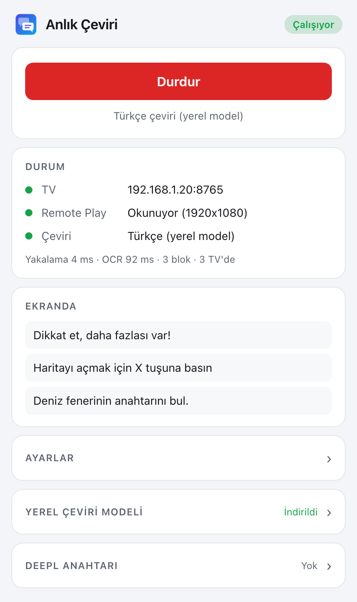
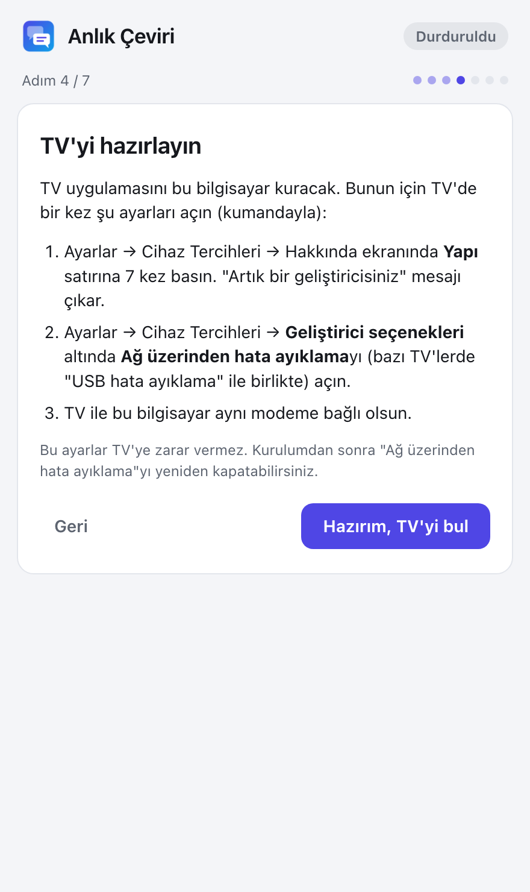
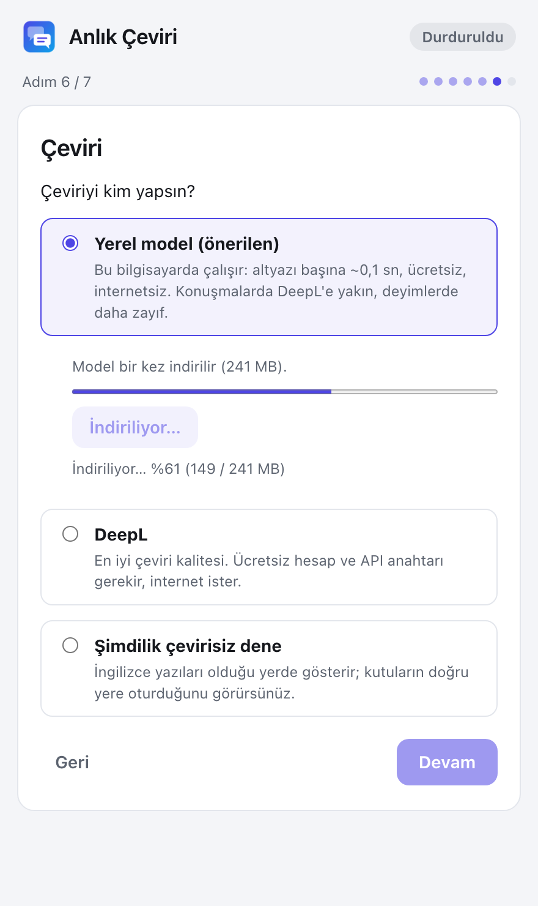
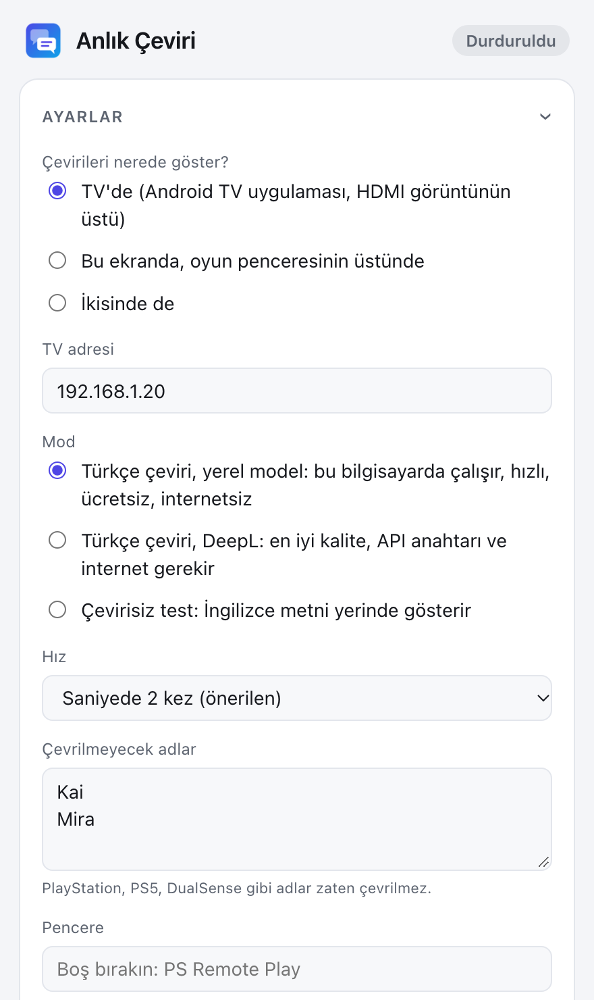

# Anlık Çeviri

PS5 oyunlarındaki İngilizce yazıları **anında Türkçeye çevirir** ve çeviriyi TV'de, yazının hemen
yanında gösterir. Oyunu her zamanki gibi TV'de oynarsınız.

```
 PS5 ──── HDMI ────▶ TV  ◀──── Türkçe çeviri ────┐
  │                                               │
  └── PS Remote Play ──▶ Bilgisayar (Mac / Windows)
                         yazıları okur ve çevirir
```

Bilgisayar, PS5 görüntüsünü PS Remote Play ile izler, yazıları okur, çevirir ve TV'ye gönderir.
Windows'ta bilgisayarda oynadığınız oyunlar da çevrilir ([PC oyunları](#pc-oyunları-windows)).

<table>
  <tr>
    <td align="center"><br><sub>Çalışırken</sub></td>
    <td align="center"><br><sub>Kurulum sihirbazı: TV</sub></td>
    <td align="center"><br><sub>Kurulum sihirbazı: çeviri</sub></td>
    <td align="center"><br><sub>Ayarlar</sub></td>
  </tr>
</table>

## Neler yapar?

- Altyazıları, görevleri ve menüleri çevirir; logo ve tabelalara dokunmaz.
- Konuşan adlarını korur: "ARTHUR: We need to go." → "ARTHUR: Gitmemiz gerekiyor."
- Hızlı konuşmada önceki satır TV'de bir süre küçük ve soluk kalır; okumadan kaybolmaz.
- Oyun profiliyle karakter adlarını ve oyuna özel terimleri doğru kullanır.
- İnternetsiz çalışır (yerel model) ya da isterseniz DeepL kullanır.

## Neler gerekiyor?

- **PS5** ve ücretsiz **PS Remote Play** uygulaması
- **Mac** (Apple Silicon, macOS 15+) ya da **Windows 10/11** bilgisayar
- **Android TV / Google TV** (Vestel, TCL, Philips, Sony…). Samsung ve LG'de çeviri bilgisayar
  ekranında görünür.
- Hepsi **aynı ev ağında**

Hesap gerekmez: çeviri bilgisayardaki yerel modelle yapılır (bir kez ~241 MB iner).

## İndirme ve kurulum

1. **[Son sürümü indirin](https://github.com/isacetin/ps5-anlik-ceviri/releases/latest)**:
   Mac için `.dmg`, Windows için `.exe`.
2. **Mac:** Anlık Çeviri'yi Uygulamalar klasörüne sürükleyin. "Doğrulanamadı" uyarısı çıkarsa
   Sistem Ayarları → Gizlilik ve Güvenlik → **Yine de Aç**.
   **Windows:** Dosyayı çalıştırın. Uyarı çıkarsa **Ek bilgi → Yine de çalıştır**.
3. Uygulamayı açın. **Kurulum sihirbazı** gerisini adım adım yaptırır; TV uygulamasını da kendisi
   kurar. TV'de yalnızca bir ayarı açmanız gerekir: Ayarlar → Geliştirici seçenekleri →
   **Ağ üzerinden hata ayıklama**.

> Uyarılar, uygulama henüz Apple ve Microsoft tarafından imzalanmadığı için çıkar.

**Güncelleme:** Yeni sürümü aynı şekilde kurun; ayarlarınız korunur. TV uygulamasını güncellemek
için Ayarlar → **Kurulum sihirbazını aç** → **Bu TV'ye kur**.

## Kullanım

1. PS5'i ve TV'yi açın; bilgisayarda PS Remote Play ile PS5'e bağlanın.
2. Anlık Çeviri'de **Başlat**'a basın.
3. TV'de PS5'in girişine geçip oynayın. Çeviriler ilk açılışta ~30 saniye içinde gelir.

### PC oyunları (Windows)

1. Oyunun ekran modunu **Kenarlıksız pencere** ya da **Pencere** yapın.
2. Anlık Çeviri'de **"Bu bilgisayarda yüklü bir oyunda"**yı seçip oyunun penceresini seçin.
3. **Başlat**'a basın. Çeviriler oyunun üstünde görünür.

| Kısayol | Ne yapar |
|---|---|
| <kbd>Ctrl</kbd>+<kbd>Shift</kbd>+<kbd>T</kbd> | Çevirileri gizler / gösterir |
| <kbd>Ctrl</kbd>+<kbd>Shift</kbd>+<kbd>R</kbd> | Yalnızca seçtiğiniz bölgeyi (ör. altyazı bandı) okur |

### Yerel model mi, DeepL mi?

**Yerel model** ücretsizdir, internetsiz ve hızlı çalışır; çoğu oyun için yeterlidir. **DeepL**
biraz daha doğal çevirir ama ücretsiz hesap ve internet ister (ayda 500.000 karakter).
Karşılaştırma: [docs/yerel-ceviri-karsilastirma.md](docs/yerel-ceviri-karsilastirma.md).

## Sorun mu var?

| Sorun | Çözüm |
|---|---|
| Çeviri gelmiyor | Uygulamadaki **Teşhis** bölümü sorunun nerede olduğunu söyler. |
| Görüntü donmuş görünüyor | Remote Play penceresini küçültmeyin; gerekirse PS5'e yeniden bağlanın. |
| Sihirbaz TV'yi bulamıyor | TV'de "Ağ üzerinden hata ayıklama" açık mı, aynı ağda mı? Adresi elle girin. |
| Oynarken Remote Play kopuyor | Kontrolcüyü bilgisayara bağlayın. |
| Yazılar yanlış okunuyor | Remote Play penceresini büyütün ya da tam ekran yapın. |
| Kutular yazıya tam oturmuyor | TV'nin resim formatını "Tam Piksel" / "Just Scan" yapın. |
| Bir ad çevriliyor | Ayarlar → **Çevrilmeyecek adlar**'a ekleyin. |
| "DeepL: kota doldu" | Ay sonunu bekleyin ya da yerel modele geçin. |

**TV uygulamasını kaldırmak için:** TV'de Ayarlar → Uygulamalar → PS5 Çeviri → Kaldır, ya da
Anlık Çeviri'de Ayarlar → **TV uygulamasını kaldır**.

## Bilinen sınırlar

- Çeviri görüntünün ~0,5–1,5 saniye gerisinden gelir.
- Süslü logo yazıları bazen yanlış okunur.
- Kurulum dosyaları henüz imzasızdır.
- PC oyunu modu yalnızca Windows'ta var ve henüz gerçek oyunlarda denenmedi.

## Geliştiriciler

Mimari, TV protokolü, derleme ve testler: **[docs/TEKNIK.md](docs/TEKNIK.md)**.
Sürüm notları: [docs/surum-notlari](docs/surum-notlari).

```bash
cd desktop && cargo test --workspace
```
