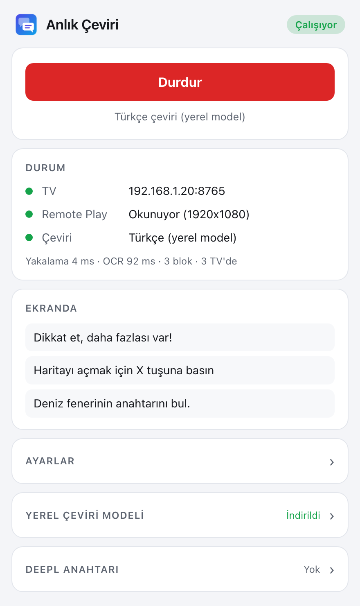
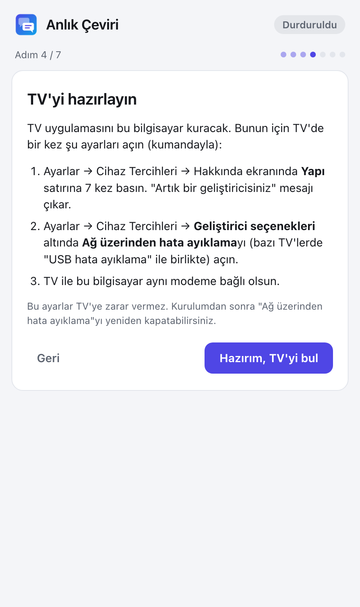
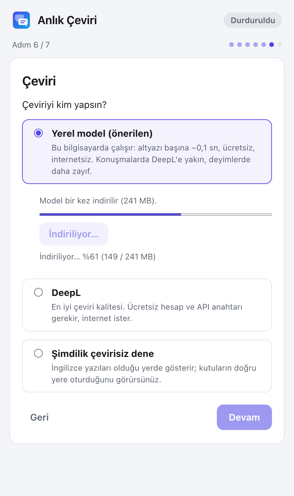
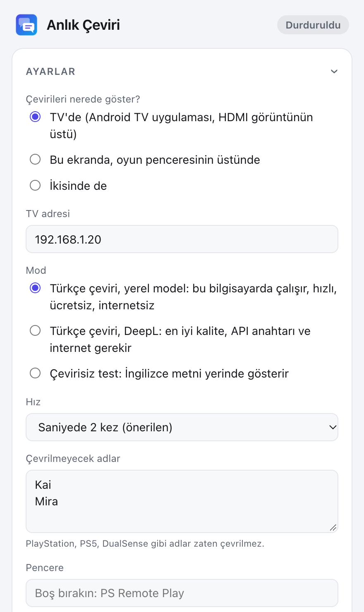

# Anlık Çeviri

PS5'te oynadığınız oyunlardaki İngilizce yazıları **anında Türkçeye çevirir** ve çeviriyi orijinal
yazının **tam üstünde** gösterir: TV'de ya da bilgisayar ekranında.

```
 PS5 ──── HDMI ────▶ TV  ◀──── Türkçe çeviri ────┐
  │                                               │
  └── PS Remote Play ──▶ Bilgisayar (Mac / Windows)
                         yazıları okur ve çevirir
```

Oyunu her zamanki gibi TV'den, gecikmesiz izlersiniz. Bilgisayar aynı görüntüyü PS Remote Play
üzerinden okur, yazıları bulup çevirir ve TV'ye (ya da kendi ekranına) gönderir.

**Windows'ta PC oyunları da çevrilir:** Steam, Epic vb. ile bilgisayarda oynadığınız oyunlarda PS5
gerekmez; yazılar doğrudan oyun penceresinden okunur ve çeviri oyunun üstünde gösterilir
([ayrıntılar](#pc-oyunları-windows)).

> Geliştirme aşamasında. Mac + Vestel Android TV + PS5 ile denendi; Windows sürümü henüz gerçek bir
> bilgisayarda denenmedi.

<table>
  <tr>
    <td align="center"><br><sub>Çalışırken</sub></td>
    <td align="center"><br><sub>Kurulum sihirbazı: TV</sub></td>
    <td align="center"><br><sub>Kurulum sihirbazı: çeviri</sub></td>
    <td align="center"><br><sub>Ayarlar</sub></td>
  </tr>
</table>

## Neler gerekiyor?

- **PS5** ve ücretsiz **PS Remote Play** uygulaması (PC oyunlarında gerekmez)
- **Mac** (macOS 15 ya da üstü, Apple Silicon) veya **Windows 10/11** bilgisayar
- Çeviriyi TV'de görmek için **Android TV / Google TV** (ör. Vestel, TCL, Philips, Sony).
  Samsung ve LG TV'lerde çeviri bilgisayar ekranında gösterilir.
- Çeviri için hiçbir hesap gerekmez: **yerel model** bilgisayarda çalışır (bir kez ~241 MB iner).
  İsterseniz daha yüksek kalite için ücretsiz **DeepL API Free** hesabı (ayda 500.000 karakter)
  kullanabilirsiniz.
- TV, bilgisayar ve PS5 **aynı ev ağında**

## İndirme

Son sürümü **[Releases](https://github.com/isacetin/ps5-anlik-ceviri/releases/latest)** sayfasından
indirin:

| Sistem | Dosya | Boyut |
|---|---|---|
| Mac (Apple Silicon) | `AnlikCeviri_0.3.1_mac_aarch64.dmg` | ~14 MB |
| Windows (64 bit) | `AnlikCeviri_0.3.1_windows_x64-setup.exe` | ~17 MB |

TV uygulaması dosyalara gömülüdür; ayrıca indirmeniz gerekmez.

## Kurulum

**Mac:** `.dmg` dosyasını açın ve **Anlık Çeviri**'yi Uygulamalar klasörüne sürükleyin. İlk açılışta
"doğrulanamadı" uyarısı çıkarsa **Sistem Ayarları → Gizlilik ve Güvenlik** altındaki
**Yine de Aç** düğmesine basın.

**Windows:** `.exe` dosyasını çalıştırın. "Windows bilgisayarınızı korudu" uyarısı çıkarsa
**Ek bilgi → Yine de çalıştır** deyin. Kurulum Türkçedir.

> Bu uyarılar, uygulama henüz Apple ve Microsoft tarafından imzalanmadığı için çıkar.

Uygulama ilk açıldığında **kurulum sihirbazı** her şeyi adım adım yaptırır:

1. Çevirileri nerede görmek istediğinizi seçersiniz (TV, bilgisayar ekranı ya da ikisi).
2. Mac'te ekranı okuma iznini verirsiniz.
3. PS Remote Play'i açıp PS5'e bağlanırsınız.
4. **TV uygulamasını sihirbaz kurar.** Siz yalnızca TV'de bir ayarı açarsınız (Ayarlar → Geliştirici
   seçenekleri → **Ağ üzerinden hata ayıklama**) ve TV'nin sorduğu izni onaylarsınız. Kurulum,
   TV'de bir test yazısıyla biter.
5. Kontrolcüyü (DualSense) bilgisayara bağlarsınız.
6. Çeviriyi kimin yapacağını seçersiniz: **yerel model** (önerilen; modeli sihirbaz indirir),
   **DeepL** (anahtarınızı girersiniz) ya da önce çevirisiz deneme modu.

## Kullanım

1. PS5'i ve TV'yi açın; bilgisayarda PS Remote Play'i açıp PS5'e bağlanın.
2. **Anlık Çeviri**'yi açıp **Başlat**'a basın.
3. TV'de PS5'in HDMI girişine geçip oynayın. İlk açılışta yazıların görünmesi ~30 saniye sürer.

**Ayarlar**'dan şunları değiştirebilirsiniz: çevirilerin nerede gösterileceği, çevrilmemesi gereken
adlar (oyun, karakter, yer adları), çeviriyi yerel modelin mi DeepL'in mi yapacağı, çevirisiz test
modu ve okuma hızı. Kurulum sihirbazı da buradan yeniden açılır.

### PC oyunları (Windows)

Bilgisayarda yüklü oyunlar (Steam, Epic, Xbox uygulaması vb.) PS5'ten bağımsız çevrilir:

1. Oyunu açın. Oyunun grafik ayarlarında ekran modunu **Kenarlıksız pencere** (Borderless) ya da
   **Pencere** yapın; "Tam ekran" (özel tam ekran) modunda çeviriler oyunun üstünde görünmez.
2. Anlık Çeviri'de sihirbazın ilk adımında **"Bu bilgisayarda yüklü bir oyunda"**yı seçin (ya da
   Ayarlar → **Ne oynuyorsunuz?**) ve listeden oyunun penceresini seçin.
3. **Başlat**'a basıp oyuna dönün. Çeviriler İngilizce yazıların üstünde görünür.

Oyun içindeyken:

| Kısayol | Ne yapar |
|---|---|
| <kbd>Ctrl</kbd>+<kbd>Shift</kbd>+<kbd>T</kbd> | Çevirileri gizler / geri getirir |
| <kbd>Ctrl</kbd>+<kbd>Shift</kbd>+<kbd>R</kbd> | Okunacak bölgeyi seçtirir: fareyle bir dikdörtgen çizin (ör. altyazı bandı). Esc vazgeçer, sağ tık tüm ekrana döner. |

Bölge seçmek, arayüzü kalabalık oyunlarda yalnızca altyazının çevrilmesini sağlar ve okumayı
hızlandırır. Bölge her oyun için ayrı saklanır; Ayarlar'dan da seçilip temizlenebilir. Kısayollar
yalnızca çeviri çalışırken etkindir.

### Yerel model mi, DeepL mi?

| | Yerel model | DeepL |
|---|---|---|
| Hız | Altyazı başına ~0,1 sn | İnternet hızına bağlı |
| Kalite | Konuşmalarda DeepL'e yakın; deyimlerde ve bazı menü terimlerinde daha zayıf | En iyi |
| Gerekenler | Bir kez ~241 MB indirme | Ücretsiz hesap, API anahtarı, internet |
| Sınır | Yok | Ayda 500.000 karakter |

Ölçüm ayrıntıları: [docs/yerel-ceviri-karsilastirma.md](docs/yerel-ceviri-karsilastirma.md). Yerel
model, Helsinki Üniversitesi'nin [OPUS-MT](https://huggingface.co/Helsinki-NLP/opus-mt-tc-big-en-tr)
modelidir (CC-BY 4.0).

## TV uygulamasını kaldırma

TV uygulaması sıradan bir uygulamadır; TV'nize zarar vermez ve istediğiniz zaman kaldırılır:

- TV'de **Ayarlar → Uygulamalar → PS5 Çeviri → Kaldır**, ya da
- Anlık Çeviri'de **Ayarlar → TV uygulamasını kaldır**.

Kurulumdan sonra TV'deki "Ağ üzerinden hata ayıklama"yı kapatabilirsiniz; TV uygulaması çalışmaya
devam eder (yalnızca güncellemek için yeniden açmanız gerekir).

## Sık karşılaşılan sorunlar

| Sorun | Çözüm |
|---|---|
| Sihirbaz TV'yi bulamıyor | TV'de "Ağ üzerinden hata ayıklama" açık mı? TV ve bilgisayar aynı modemde mi? TV'nin adresini (Ayarlar → Ağ ve İnternet) elle girin. |
| Oynamaya başlayınca Remote Play kopuyor | Kontrolcü PS5'e bağlı. Bilgisayara bağlayın (kablo ya da Bluetooth). |
| Yazılar yanlış okunuyor | Remote Play penceresini büyütün ya da tam ekran yapın. |
| TV'de kutular yazının üstüne tam oturmuyor | TV'nin resim formatını "Tam Piksel" ya da "Just Scan" yapın. |
| Oyun ya da karakter adı çevriliyor | Ayarlar → **Çevrilmeyecek adlar**'a ekleyin. |
| PC oyununda "Oyun görüntüsü alınamıyor (kare siyah)" | Uygulama önce pencereyi, siyah gelirse ekranın tamamını okumayı dener; ikisi de siyahsa oyunun ekran modunu "Kenarlıksız pencere" (Fullscreen Borderless) ya da "Pencere" yapın. |
| PC oyunu listede yok | Oyun açık ve simge durumunda değil mi? Listedeki **Yenile**'ye basın. |
| PC oyununda ekran yazıyla doluyor | <kbd>Ctrl</kbd>+<kbd>Shift</kbd>+<kbd>R</kbd> ile yalnızca altyazı bandını seçin. |
| "DeepL: kota doldu" | Aylık 500.000 karakter bitti; yeni ayda açılır. Bu arada Ayarlar'dan yerel modele geçebilirsiniz. |
| "Yerel çeviri modeli indirilmemiş" | Ayarlar → **Yerel çeviri modeli** → İndir. İndirme yarıda kalırsa tekrar basın; kaldığı dosyadan devam eder. |

## Bilinen sınırlar

- Çeviri, görüntünün yaklaşık **0,5–1,5 saniye** gerisinden gelir; çok hızlı akan altyazılarda geride
  kalabilir.
- Oyun logolarındaki süslü yazılar bazen yanlış okunur.
- Mac'te Remote Play **tam ekrandayken** bilgisayar ekranı modunun çalışması henüz denenmedi.
- Kurulum dosyaları henüz imzasızdır (yukarıdaki uyarılar).
- PC oyunu modu yalnızca Windows'ta var ve henüz gerçek oyunlarda denenmedi. Özel tam ekran oyunlar,
  bazı hile korumalı (anti-cheat) oyunlar ve korumalı pencereler yakalanamayabilir.

## Geliştiriciler

Mimari, iş hattının ayrıntıları, TV protokolü, kaynak koddan derleme ve testler:
**[docs/TEKNIK.md](docs/TEKNIK.md)**.

```bash
./gradlew assembleRelease
```

```bash
cd desktop && cargo run --release -p ceviri-app
```

```bash
cd desktop && cargo test --workspace
```
